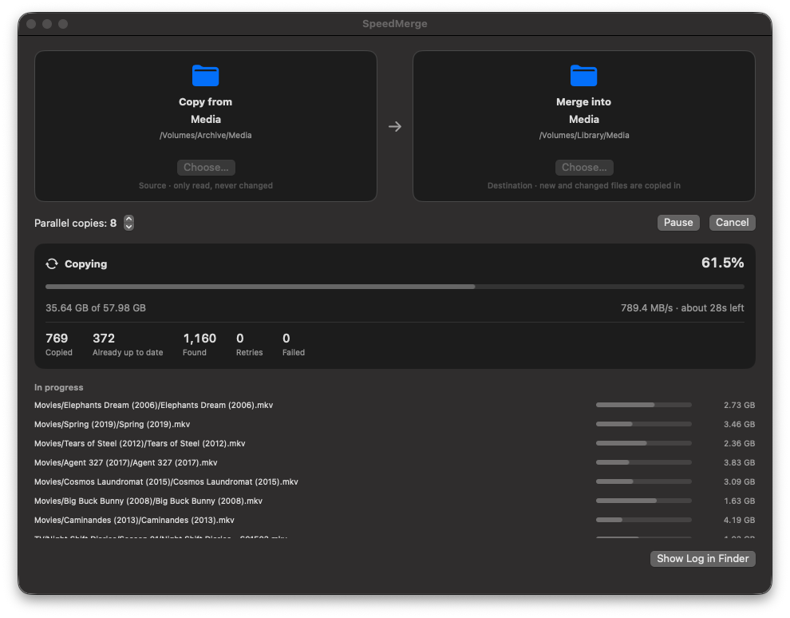
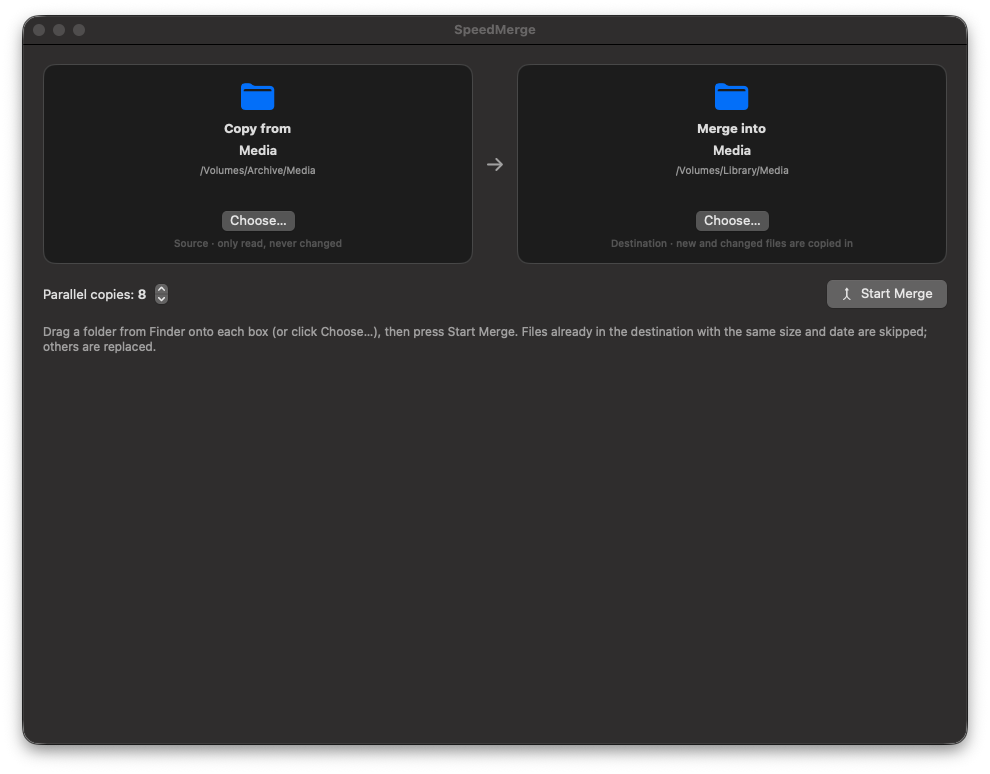
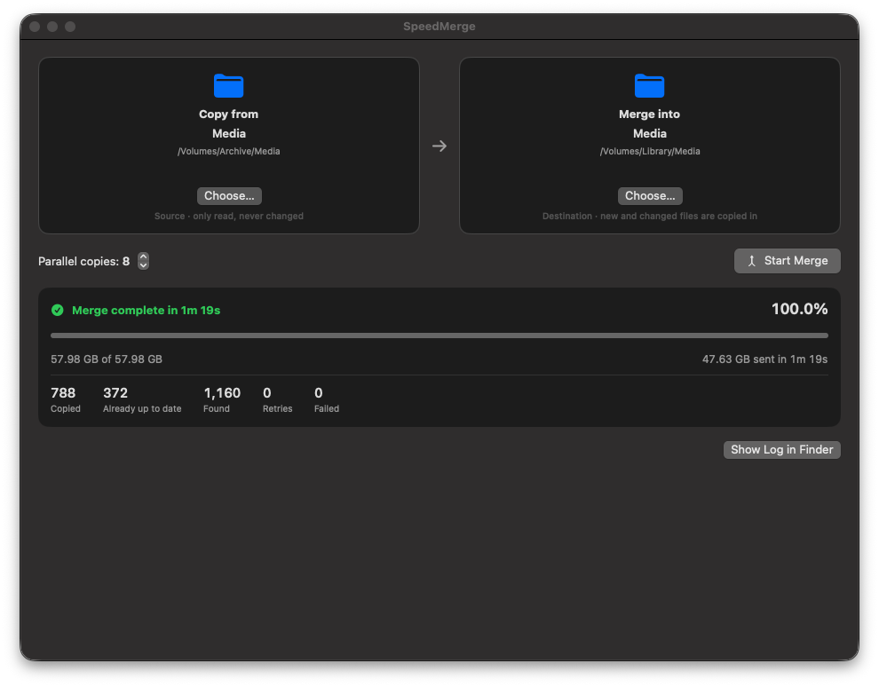
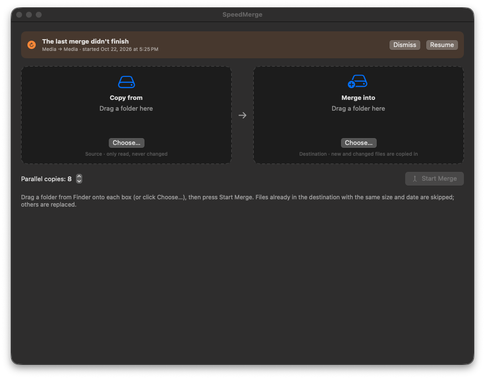

<p align="center">
  
</p>

<h1 align="center">SpeedMerge</h1>

<p align="center">
  <strong>Merge one huge folder into another, fast, with many files copying at once and resume after any interruption.</strong><br>
  Built for moving terabytes between NAS shares without babysitting the copy.
</p>

<p align="center">
  <a href="https://github.com/bytePatrol/SpeedMerge/releases/latest"></a>
  
  
  
  <a href="LICENSE"></a>
</p>

<p align="center">
  
</p>

---

## Why SpeedMerge?

Dragging a folder onto another in Finder replaces matching folders rather than merging them. It copies one file
at a time, and if anything goes wrong 9 TB into a 14 TB copy, you start over. `rsync` merges correctly, but it is
single-threaded and leaves you staring at a terminal.

SpeedMerge does one job well. It takes **Folder A** and merges everything inside it into **Folder B**, keeping the
exact directory structure:

```
Folder-A/Media/TV/Show/Season 01/Episode 01.mkv  →  Folder-B/Media/TV/Show/Season 01/Episode 01.mkv
```

Files already in the destination are left alone, new and changed files are copied in, and the source is never
modified. Many files copy at the same time, so fast networks and multi-disk arrays stay busy. Every copy can be
resumed after a stalled share, a dropped network, a crash or a reboot.

## Features

### Fast
- **Parallel copies.** Choose 1–32 simultaneous file copies (default 8), and change the number *while a merge is
  running* to find the best setting for your hardware.
- **Parallel scanning.** Several scanner threads walk the source tree at the same time, so copying starts right away,
  even on folders with millions of files.
- **Built for large files on network shares.** It uses direct `pread`/`pwrite` in 8 MB chunks with `F_NOCACHE`, so
  multi-gigabyte files don't fill the Mac's memory cache or slow down the copies running beside them.
- **Skips work that is already done.** A destination file with the same size and modification date as the source
  counts as up to date and isn't copied again.

### Safe
- **Copy only.** The source folder is only ever read: nothing is moved, renamed or deleted.
- **No half-written files.** Each file is written to a hidden `.<name>.<hash>.smpartial` file next to its final
  location. It is renamed into place only when complete, so the destination never holds a truncated file under the
  real name.
- **Overwrite when different.** A file at the same path that differs in size or date is replaced, and the copy gets
  the source's modification date.
- **Won't write to the wrong disk.** If a share disappears, macOS can leave an empty local folder at its old mount
  point. SpeedMerge checks it is still writing to the same volume, and it never creates the destination folder
  itself, so a dropped share can't silently fill your boot drive.

### Recovers from interruptions
- **Resumes after a crash or quit.** The job is saved when it starts. Next launch, a banner offers to **Resume**:
  finished files are skipped, and partial files continue where they stopped. The last 64 MB is copied again to be
  safe.
- **Stall watchdog.** A file that makes no progress for 60 seconds is abandoned and retried, up to 3 attempts with
  increasing delays. A hung network read can't freeze the whole merge.
- **Share-drop detection.** Both shares are checked every few seconds. If one goes offline, everything pauses with a
  clear *waiting for the share* status and continues on its own once it is back, even if it remounts as a new
  device. Errors caused by an outage don't use up a file's retry attempts.
- **Keeps the Mac awake** for the length of the merge. The display can still sleep.

### Clear progress
- An overall progress bar with bytes done, live speed (10-second average) and time remaining.
- Counters for copied, already up to date, found, retried and failed files.
- A live list of the files being copied right now, each with its own progress bar.
- Every failure is listed with its reason, and running the merge again retries only those files.
- A full timestamped log of each run in `~/Library/Logs/SpeedMerge/`.
- **Pause / Resume / Cancel** at any time. Cancelling keeps partial files, so starting again picks up where it
  stopped.

### Filters out NAS and macOS clutter
These are never copied: `.DS_Store`, `.Trashes`, `.Spotlight-V100`, `.fseventsd`, `.TemporaryItems`, and the common
Synology / QNAP system folders `@eaDir`, `#recycle`, `#snapshot`, `@Recycle`, `@Recently-Snapshot`, `.@__thumb`.

## Screenshots

| Choose two folders | Merge in progress |
|---|---|
|  |  |
| **Finished** | **Resume after a crash or quit** |
|  |  |

## Install

1. Download **`SpeedMerge-x.y.z.dmg`** from the [latest release](https://github.com/bytePatrol/SpeedMerge/releases/latest).
2. Open it and drag **SpeedMerge** into **Applications**.
3. The first time you open it, **right-click the app → Open → Open**. The app is ad-hoc signed and not notarized by
   Apple, so Gatekeeper asks once. Alternatively, run:
   ```sh
   xattr -dr com.apple.quarantine /Applications/SpeedMerge.app
   ```

Requires macOS 14 Sonoma or later and runs natively on Apple silicon and Intel Macs.

## Usage

1. **Copy from:** drag the source folder onto the left box (or click **Choose…**).
2. **Merge into:** drag the destination folder onto the right box.
3. Set **Parallel copies** (8 is a good start) and press **Start Merge**.

Network shares work exactly like local folders. Connect to them in Finder first (`⌘K`), then drag them in from the
sidebar or from `/Volumes`.

If you quit during a merge, SpeedMerge asks first, then stops cleanly so the merge can be resumed. If the Mac crashes
or loses power, the next launch shows the resume banner.

### Command line

The same engine runs without the window, which is useful over SSH or in scripts:

```sh
/Applications/SpeedMerge.app/Contents/MacOS/SpeedMerge --cli <source> <destination> [--parallel N]
```

```
Log: ~/Library/Logs/SpeedMerge/SpeedMerge-2026-01-15_09-30-00.log
 12.4%  412.6 GB of 3.31 TB  498.2 MB/s  copied 1830  skipped 9214  failed 0  [running]
```

It prints progress every 2 seconds and exits with `0` when every file was merged, `1` if some failed and `2` for a
usage error.

## Getting the most speed

On a fast network, the drives are usually the limit, not SpeedMerge. A few things worth checking:

| Check | Why it matters |
|---|---|
| **Link speed:** run `networksetup -getMedia Ethernet` and look for `10Gbase-T` | A bad cable or switch port can silently negotiate 1 GbE or 2.5 GbE. |
| **VPN / zero-trust network clients** | Some route LAN traffic through the tunnel, which can cut throughput by 5–10×. Turn them off or exclude the NAS subnets. |
| **Parallel copies** | Spinning-disk RAID arrays seek between files. Try 4, 8 and 12 and watch the speed. There is usually a sweet spot, and going past it adds disk latency without adding throughput. |
| **File size** | Large video files run close to wire or array speed. Folders of small photos are limited by per-file overhead and disk seeks. |

The parallel-copies stepper works live, so you can tune it during a long merge without restarting.

## How it works

```
 scanner threads (4) ──► bounded file queue ──► copy workers (N) ──► .name.hash.smpartial ──► rename into place
        │                                              ▲    │
        └─ mirror folder tree, index destination        │    └─ set source modification date
                                                       │
 watchdog ── stalled copy (60 s) ──► retry ─────────────┘
 network monitor ── share gone ──► pause all ──► share back ──► continue
```

- **Engine:** `Sources/SpeedMergeCore` is a UI-independent library. Plain POSIX I/O runs on dedicated threads
  coordinated by a single condition variable, with no third-party dependencies.
- **Partial-file names** include a hash of the source size and modification date. A partial file from an older
  version of the source is never resumed into a newer one.
- **Up to date** means same size and modification time within 2 seconds, which covers the timestamp rounding of
  SMB, exFAT and FAT.
- **Symbolic links** are recreated as links. Empty folders are created. File permissions, extended attributes and
  Finder tags aren't copied: the destination share's own permission rules apply.

## Build from source

Requires Xcode 16 or later (Swift 6 toolchain).

```sh
git clone https://github.com/bytePatrol/SpeedMerge.git
cd SpeedMerge
./build.sh            # universal SpeedMerge.app in the project folder
./build.sh --dmg      # also creates dist/SpeedMerge-<version>.dmg and .zip
swift test            # engine test suite
```

The test suite covers nested merges, skip and overwrite rules, modification-date preservation, resuming from partial
files, ignoring stale partials, stall recovery, persistent failures, cancel-and-resume, pause handling, exclusions and
a 400-file parallel run.

### Project layout

```
Sources/
  SpeedMergeCore/      merge engine, job store, logger (no UI code)
  SpeedMerge/          SwiftUI app + --cli entry point
Tests/
  SpeedMergeCoreTests/ engine tests
Resources/Info.plist   app bundle metadata
scripts/make-icon.swift  draws the app icon at build time
build.sh               builds, signs and packages the app
```

## FAQ

**Does it delete anything from the destination?**
No. It only adds files and replaces files at the same path that differ. Nothing missing from the source is removed,
so it's a merge, not a mirror.

**What happens if I run it twice?**
The second run checks every file, finds them up to date, and copies nothing. That makes re-running a cheap way to
check a finished merge or retry failures.

**Can I copy NAS-to-NAS without going through the Mac?**
SpeedMerge runs on the Mac, so data passes through it. On a 10 GbE network that usually isn't the bottleneck,
because the drives are. If you need to skip the Mac entirely, run `rsync` on one of the NAS devices instead.

**Where are the logs and the saved job?**
Logs are in `~/Library/Logs/SpeedMerge/`. The resumable job is in `~/Library/Application Support/SpeedMerge/last-job.json`.

## License

SpeedMerge is free software under the [GNU General Public License v3.0](LICENSE).
